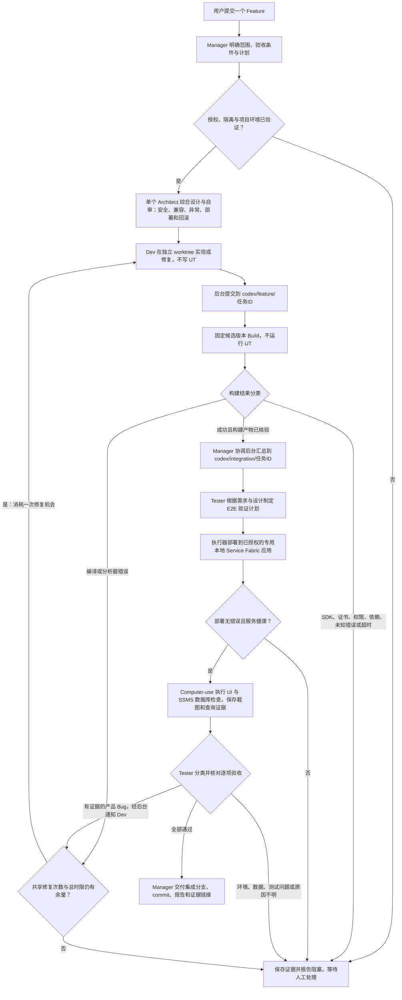
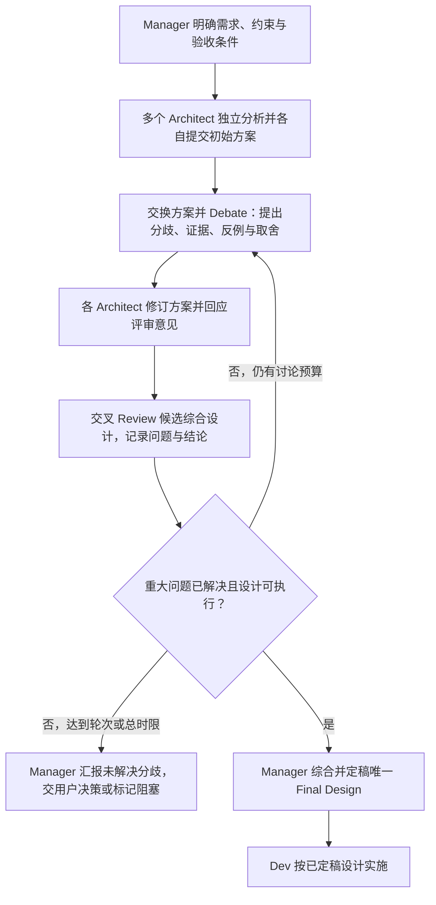

# AI Agent Manager — 需求说明

## 1. 目标

构建一个多 agent 软件工程系统。用户只通过 UI 与 Engineering Manager 对话，由 manager 理解需求、制定计划、协调多个 agent、跟踪进度和汇总结果。用户不需要手动管理各个 coding session。

系统支持两个核心场景：多 scenario 并行测试与修复，以及 feature 从设计到实现、评审、E2E 验证的完整流程。尽可能复用 Codex 的代码阅读、修改和命令执行能力。

相关设计：[[20261111 - high level design]]。本文记录需求和当前实施选择，具体 SDK 接口与环境兼容性在实现时验证。

## 2. 场景一：多个 Scenario 并行测试与修复

### 输入

- 目标仓库及待验证的代码版本。
- 多个 scenario 的描述、预期行为和验收条件。
- 测试环境、测试数据及允许修复的范围。

### 工作流

1. Manager 分析 scenario，识别依赖、共享资源和可并行任务。
2. 将独立任务分派给多个 worker；每个 worker 执行一个 scenario，完成后可以领取下一个。
3. Worker 执行测试并收集证据；失败时分析原因，区分产品 bug、测试问题、数据问题、环境问题、偶发失败和未知原因。
4. 对授权范围内的产品 bug，worker 或专门的修复角色修改代码、补充回归测试并复测。
5. 多个 scenario 命中同一个 bug 时，由 manager 指定修复负责人，其他 worker 验证该修复，避免重复修改。
6. 后台协调修复提交的集成，冲突交回相关 worker 处理。
7. 对集成后的明确代码版本运行回归测试，manager 汇总结果。

### 输出与完成条件

- 每个 scenario 的通过、失败、阻塞或取消状态。
- 实际测试命令、代码版本、环境信息及日志位置。
- Bug 分类、根因、复现步骤、修复提交和复测证据。
- 集成版本的回归结果及未解决问题。

测试失败不能直接触发产品代码修改；仅有 worker 声称成功不能视为验证通过。存在未通过或阻塞的 scenario 时，报告必须明确标识，不得将整体标为全部通过。

## 3. 场景二：Feature 从设计到验证

### 当前目标流程（2026-11-12 更新）

本节为当前四角色 MVP 的优先需求，覆盖本文早期关于多个 Architect、独立 Reviewer 和单元测试的第一版描述。Scenario 并行保留为后续目标；当前先打通单 Feature 自动交付。

- **四角色职责**：Manager 负责目标、调度与交付；单个 Architect 自行综合安全等所有设计问题；Dev 实现和修复；Tester 规划验证、分析失败并经后台向 Dev 反馈。Architect 自审不等于独立设计评审。
- **Build/Fix**：`max_fix_rounds` 默认 5，可配置 0–20，表示首次实现之外的源码修复机会；Build 与 E2E 共用预算。`total_timeout_seconds` 默认 7200，可配置 60–86400，包含澄清等待，重试不重置。超过预算或总时限停止并保留证据。
- **本期不做**：不写、不运行 UT；不启用独立 Reviewer，也不实现 Reviewer→Dev 通信。Reviewer 和多 Architect 为后续扩展，不作为本期完成条件。
- **版本一致性**：每个 Feature 一个分支；当前单 Feature 集成分支指向同一已构建候选 commit，不代表已实现多 Feature 合并。每次修复必须重新构建、部署、验证，不能复用旧版本成功证据。
- **E2E 验收**：检查实际构建/部署错误、服务健康、UI 行为及 SSMS 中业务数据的预期值。`shardmetrics`、`poolmetricx` 仅为用户举例，实际表名、schema、字段和值须先核实；不能仅凭表存在判定通过。
- **配置与交付**：项目和固定执行器由运营者预配置；后续用户可通过 UI 或符合模板的 JSON/Markdown 提交 Feature，明确授权源码/构建及本地部署/E2E。最终提供可预览的设计、分支/commit、日志、逐项验收及剩余阻塞的文件链接；不自动 push 或合并 main。
- **当前能力边界**：已有四角色编排与合成集成验证不等于真实端到端验收。真实 Agent 派发仍因隔离保护 fail-closed；实际 MSBuild 目标、部署驱动、Computer-use/SSMS 驱动与专用资源尚需配置及验证，不能绕过保护或报告真实通过。

实现说明：[四角色 Feature 交付](Q:/AIManager/docs/four-role-delivery.md)。

### 早期完整愿景（后续阶段参考，非当前 MVP 验收要求）

#### 后续明确需求：多个 Architect Debate + Review → 最终设计

当前 MVP 先使用一个 Architect；后续必须支持多个独立 Architect，不是单个 Agent 切换提示词模拟多个视角。流程为：

- **独立提案**：至少两个 Architect 使用独立执行上下文，首轮不读取其他 Architect 的方案，避免先入为主；覆盖整体架构、安全、兼容性、异常路径、部署、回滚和可验证性。
- **Debate**：由后台转发方案和问题，围绕具体分歧进行有证据的讨论，而非简单投票；记录各方案优缺点、反对意见及回应。
- **Review**：Architect 交叉审查候选综合设计，逐项给出通过、需修改或阻塞结论；未关闭的重大问题不能被 Manager 静默忽略。
- **最终定稿**：Manager 基于 Debate 和 Review 形成唯一版本化 Final Design，包含选定方案、取舍理由、未采用方案、风险、验收映射及实施步骤；Dev 只能基于该明确版本开始实施。重大需求歧义或无法收敛的分歧交用户决策。
- **收敛与追溯**：讨论轮次和总时限可配置，耗尽后保留证据并停止自动推进；初始提案、讨论、修订、Review 和最终设计均持久化并提供预览链接。后续实施发现设计不成立时，重新进入该设计流程并更新设计版本。
- **范围边界**：这是后续必须实现的设计阶段能力，当前单 Architect 自审不视为已完成；也不意味着恢复 UT 或启用 Reviewer→Dev 通信，二者仍按各自阶段范围单独决定。

### 输入

- Feature 描述、目标仓库和相关业务背景。
- 功能范围、兼容性要求、约束及验收条件。

### 工作流

1. Manager 理解需求，形成验收条件、任务计划和依赖关系。影响实施的需求歧义向用户澄清。
2. 多个 architect 独立阅读相关代码和需求，分别提出方案。可以分别关注整体设计，以及兼容性、异常路径和可测试性。
3. Architects 交叉评审，围绕具体分歧进行有限轮次的讨论。
4. Manager 汇总方案、取舍和未解决问题，形成设计决策；依据已配置的授权策略判断是否需要用户决策。
5. Dev 在独立 worktree 中按设计实现代码和单元测试，运行构建及相关检查。
6. 独立 reviewer 评审指定代码版本；问题回到 dev 修复。
7. Test 根据需求和验收条件独立设计验证，执行相关集成测试和 E2E，保存实际证据。
8. 失败经过分类后回到适当角色；产品 bug 进入开发修复与复测循环，环境问题进入环境排查。
9. 实现发现设计不成立时，显式重新进入设计评审，记录变更原因。
10. Manager 核对集成版本的验收结果，输出最终工程报告。

### 输出与完成条件

- 需求与验收条件、独立架构方案、交叉评审和最终设计决策。
- 实现提交、代码 diff、构建和单元测试结果。
- 独立代码评审、E2E 与回归结果。
- 剩余风险、限制及需要用户决定的事项。

只有指定代码版本满足验收条件，并完成要求的评审与测试，才能标记 feature 完成。讨论与修复循环必须有上限；无法收敛时保留证据并向用户报告阻塞。

## 4. 第一版必须保留 UI

采用轻量 UI，初步选择 Streamlit。第一版包含：

- **Manager 对话**：提交 feature 或 scenario，补充需求并接收汇报。
- **任务进度**：查看当前阶段、各角色任务状态、失败和阻塞原因。
- **产物查看**：查看设计文档、代码 diff、评审、测试日志和最终报告。
- **运行控制**：取消任务、重试失败任务，处理需要用户决定的事项。

后台独立执行工作流。刷新或关闭页面不应中断任务；重新打开 UI 后，通过 workflow ID 恢复状态与产物展示。UI 中的任务状态来自持久化执行记录，不仅来自 manager 的聊天描述。

## 5. Agent、Thread 与后台编排

### 当前选择

- Manager 本身使用一个持续的 Codex thread，与用户进行多轮对话。
- Architect、dev、reviewer 等顶层 worker 使用独立 Codex threads，由后台调度。
- Test 的实际命令由测试执行器运行，需要规划或分析时使用 Codex thread。
- 第一版不依赖 Codex 内部 subagent；以后可用于 worker 内部的临时探索。

`Role` 是职责配置，`thread` 是执行对话上下文，`session` 在本文中作为宽泛叫法。一个角色可以执行多个任务，不要求永久保留一个常驻 thread；连续开发与修复可恢复同一任务 thread。

### 通信

独立 threads 不假定自动互通。第一版由后台提供集中消息转发：worker 向 manager 汇报，manager 根据需要通知其他 worker。架构交叉评审也通过后台投递方案和问题。

重要信息以结构化结果和产物引用传递，不依赖复制完整聊天历史。直接 worker 间通信可以后续扩展。

### 编排与 Codex 接入

- LangGraph 管理阶段、依赖、并行、路由、重试及检查点。
- Codex manager 负责需求理解、规划建议和汇报；后台校验结构化动作后实际执行调度。
- Python 后台可通过小型 Node/TypeScript Codex SDK 适配服务管理 threads。具体接入在技术验证阶段确定；需要更完整交互时评估 app-server。
- SQLite 保存工作流与执行状态，本地文件保存产物。
- CrewAI 不进入第一版关键执行路径。

## 6. 代码与测试环境隔离

- 每个并行代码修改任务使用独立 Git worktree。
- Architect 和 reviewer 默认只读，未必需要独立 worktree。
- 记录 base commit、修复 commit 和最终集成 commit。
- Test 验证指定提交；验证期间不能继续修改被测目录。
- Worktree 只隔离文件，不自动隔离端口、数据库、队列、连接 ID 或服务实例。
- 针对 GraphConnectors，检查构建输出、MSBuild、证书、Service Fabric 及外部测试资源的使用方式。
- 第一版允许设计、开发、单元测试及不冲突的 scenario 并行；Service Fabric E2E 先使用一个测试环境串行验证。
- 后续按需评估一个 SF 集群内多个应用实例，或独立 Windows VM 测试环境；Docker 不作为第一版默认前提。

## 7. 可靠性与授权

- 持久化 workflow ID、task ID、attempt ID、角色、Codex thread ID、阶段、重试次数及产物引用。
- 设置并发限制、超时、取消和有限重试。
- 恢复时检查已有执行与产物，避免重复创建环境、修改代码或启动测试。
- 所有测试记录命令、退出状态、代码版本、环境和日志。
- 长日志与完整代码存入产物文件，工作流状态保存引用。
- 授权策略遵循用户已给定的范围；常规设计、隔离目录中的开发和测试可以按授权自动推进，不重复要求确认。
- 需要用户决定的事项由 UI 呈现，保留决定及对应的设计或代码版本。
- 不自动将无法验证的结果报告为完成。

## 8. 第一版落地与验收顺序

1. **最小真实闭环**：UI 提交一个任务，manager thread 分派真实 Codex worker，创建 worktree、执行修改和测试，返回持久化结果。
2. **并行 scenario**：三个独立 scenario 并行测试，完成失败分类、修复、集成与回归。
3. **小 feature**：两个 architect、一个 dev、按需 reviewer、一个 test，完成设计到验证。角色分阶段执行，不要求全部常驻。
4. **恢复与控制**：刷新 UI、重启后台、取消或重试任务后，状态一致且不会重复执行已有副作用。

第一版成功标准：用户只需与 manager 交流，即可通过 UI 观察两类工作流推进，并取得可追溯、可复核的设计、代码和测试结果。
