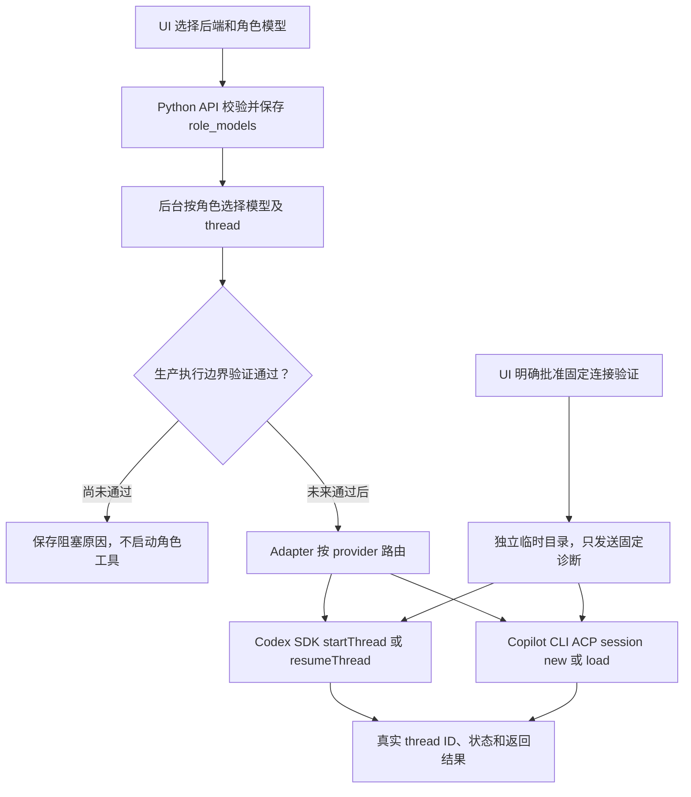

# 模型与账号：Codex SDK / GitHub Copilot

## 本次范围与能力边界

新增 UI 模型面板、账号状态检查、模型目录、每角色 provider/model/effort 配置，以及真实固定连接验证。Codex 使用现有 TypeScript SDK；GitHub Copilot 使用本机官方 Copilot CLI 的 ACP 接口，不复制 yeaft 的直接 API 引擎或私有 token 交换实现。

**模型能返回结果不等于代码交付链路已开放。** Codex 的 Windows 网络隔离问题仍保留 fail-closed；Copilot 的工具执行隔离尚未验证，所有权限请求默认拒绝。两种生产角色派发都不能通过修改配置解除保护。本次没有实现自由聊天窗口、真实源码修改/Build/SF/E2E 自动验收，也没有写或运行产品 UT。

## 账号与登录

在运行后台的同一 Windows 用户下，打开自己的 PowerShell：

```powershell
codex login
codex login status
copilot login
```

Codex 使用 CLI 已有认证和模型 Provider 配置，可由其支持的 ChatGPT/API Key 方式登录；不要求在 AIManager 重填密钥。Copilot 使用自己的 GitHub/Copilot 授权，是否能访问模型受账号权益、组织策略和 CLI 认证状态影响。AIManager 不创建共享登录账号，也不替用户选择其他 GitHub 身份。两者认证互不替代；应用 GitHub 登录、Git 仓库访问权限和 Copilot 模型权限也不是一回事。

CLI 不在 PATH 时，可在启动前设置 `AIM_CODEX_EXE`、`AIM_COPILOT_EXE` 为实际 `.exe` 绝对路径；不能使用拼接的 shell 命令。UI 不收集、返回或保存 API Key、OAuth token，也不在浏览器中代做账号授权。

Copilot 如返回 `GitHub CLI could not provide a token for the selected account`，需先在本机修复所选账号的 GitHub/Copilot 认证，再重新获取目录/验证；不能把一次历史成功当作当前认证仍可用。不要将 token 粘贴到 Feature、报告或 Git 提交中。

也支持运营者显式选择已有 GitHub CLI 认证（不自动切换身份）：

```powershell
gh auth login --hostname github.com
$env:AIM_COPILOT_AUTH_SOURCE = 'github-cli'
$env:AIM_COPILOT_GITHUB_HOST = 'github.com'
```

可选 `AIM_COPILOT_GITHUB_USER` 指定已登录用户名，`AIM_GH_EXE` 指定 `gh.exe` 路径。设置后重启 Adapter；它只在子进程内存环境中设置 Copilot CLI 官方支持的 `COPILOT_GITHUB_TOKEN`，不返回或写盘保存 token。取 token 或验证失败就报错，不降级到另一身份。未设置该选项时继续使用 Copilot CLI 自身的认证。

## UI 操作

先按 [启动停止说明](start-stop.md) 重启后台、Adapter 和 UI；只刷新旧页面不足以加载新后端接口。

1. 展开“模型与账号：Codex SDK / GitHub Copilot”，点击“检查账号与后端状态”。`installed` 只代表 CLI 可发现；Copilot 的 `authenticated=null` 代表尚未验证，不是假定已登录。
2. 选择 `codex` 或 `copilot`，点击“获取模型目录”。Codex 优先读本地模型缓存，无缓存时通过 app-server `model/list` 获取；Copilot 通过 ACP 初始化会话获取实际目录，不用静态模型清单伪装账号能力。目录不保证模型调用权限。
3. 选择目录模型，或手动填写模型 ID。Codex 支持传递推理强度；目录可用时按目录展示选项。Copilot ACP 推理强度 setter 尚未验证，因此不发送该参数。空模型只允许任务继承后端默认值；连接验证要求明确选择模型。
4. 勾选批准一次真实连接验证，点击验证，再刷新结果。此操作可能产生用量，只在 Adapter 专用临时目录发送固定 JSON 诊断，不接收用户 prompt、仓库路径或执行命令，不是 Feature 任务入口。
5. 勾选“将模型选择写入新任务”，必要时为各角色覆盖。UI 显示最终配置；新任务保存 `role_models` 快照。关闭此选项时，手工新任务默认 Codex，上传文件的角色配置保留。启用时明确用面板配置覆盖上传文件。

UI 选择保存在当前 Streamlit session；尚未实现服务端永久账号/模型设置。任务配置会持久化。修改已提交任务的模型必须使用新的任务/幂等键，不能修改历史任务快照。

## 实际调用链



固定探测是单独的受限诊断路径，不将生产 `ready` 改为 true。Codex 探测额外关闭 shell/unified-exec 和项目文档加载，并在发现非预期工具事件时中止；这不是完整 OS 隔离证明。Copilot 拒绝权限请求及客户端工具，并在发现工具调用时停止；取消子进程不等于已证明所有后代进程终止。认证、模型响应、工具执行与完整交付必须分别验收。

## JSON / Markdown

在 Feature JSON 中增加以下字段；模型 ID 从实际目录选择。Markdown 仍使用唯一的 fenced JSON 块。

```json
{
  "role_models": {
    "manager": {"provider": "codex", "model": "MODEL_ID_FROM_CODEX", "effort": "low"},
    "architect": {"provider": "codex", "model": "MODEL_ID_FROM_CODEX"},
    "dev": {"provider": "copilot", "model": "MODEL_ID_FROM_COPILOT"},
    "test": {"provider": "copilot", "model": "MODEL_ID_FROM_COPILOT"}
  }
}
```

上面只是可合入模板的字段片段，不是独立 Feature 文件。完整示例见 [带模型配置的 Feature 模板](../templates/feature-models.json)。未配置角色继续使用 Codex 默认配置。模型/provider/effort 与 thread 绑定，不能在恢复同一 thread 时静默换模型。

## API 与真实验收

本机真实证据见 [模型连接验收记录](evidence/model-provider-connectivity.json)：经真实 HTTP API 的 Codex SDK 和 Copilot ACP 固定探测均返回 connected=true，且 UI 面板在真实后台下完成渲染；Copilot 最终验证显式使用 GitHub CLI 认证。原生 Copilot CLI 认证期间曾出现所选账号凭据错误，因此不能声称所有认证模式都始终可用。Codex 曾报告模型 metadata fallback，记录的是请求模型，不冒充已确认的上游实际模型。

- `GET /models/providers`：安装/认证可检测状态及执行阻塞原因，不返回凭据。
- `POST /models/catalog`：请求 `{"provider":"codex"}` 或 `{"provider":"copilot"}`。
- `POST /models/probes`：请求 provider、显式 model、可选 effort 和 `approved:true`，异步返回 ID；不接受用户 prompt/cwd。
- `GET /models/probes/{id}`：查看真实结果、thread ID、请求模型与可用用量。请求模型不冒充服务端已证实的实际路由模型；`auto` 可能由 Copilot 自行路由。
- 运行中只允许一次连接探测；记录保存在 Adapter 数据目录的 `model-probes`。重启后未完成探测显示 interrupted，不自动重放。

集成验证脚本（`--live` 明确批准真实模型用量，不运行产品 UT）：

```powershell
Set-Location -LiteralPath 'Q:\AIManager'
.\.venv\Scripts\python.exe acceptance/model_provider_smoke.py `
  --node 'C:\PATH\TO\node.exe' `
  --codex-model 'MODEL_ID_FROM_CODEX' `
  --copilot-model 'MODEL_ID_FROM_COPILOT' `
  --live
```

脚本创建独立端口/数据目录的后台和 Adapter，走真实 HTTP API，并检查 UI 渲染；退出只停止自己创建的服务，不重启现有服务。去掉 `--live` 只验证目录/API/UI。

实现参考：[Codex SDK](https://developers.openai.com/codex/sdk)、[Copilot ACP 文档](https://docs.github.com/en/copilot/reference/acp-server)、本机 yeaft 的 Provider/ACP 设计。未修改 yeaft 仓库。
